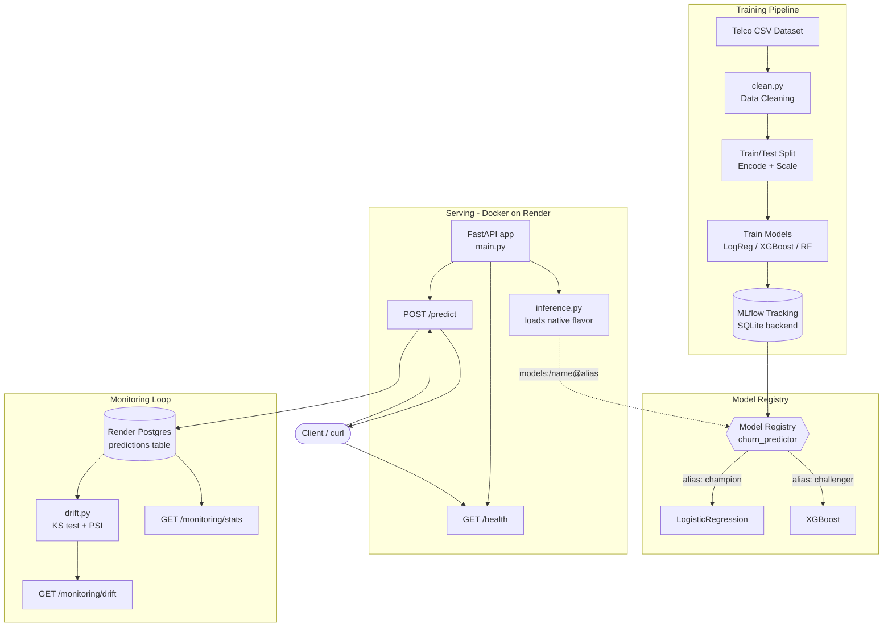

# Churn MLOps — End-to-End Customer Churn Prediction System

A production-style ML system (not just a trained model) for predicting customer churn on the IBM Telco Customer Churn dataset. Covers data cleaning, model training, experiment tracking, a model registry with champion/challenger aliasing, containerized API serving, live monitoring with drift detection, and a CI/CD pipeline that gates deployments on passing tests.

**Live API:** https://churn-mlops-hm0l.onrender.com
**Repo:** https://github.com/2004keshav/churn-mlops

> Note: deployed on Render's free tier — the service spins down after 15 minutes of inactivity. The first request after idle may take 30-60s to respond (cold start); subsequent requests are fast.

## Quick Start — Try the Live API

```bash
# Health check
curl https://churn-mlops-hm0l.onrender.com/health

# Prediction (champion model)
curl -X POST "https://churn-mlops-hm0l.onrender.com/predict?model=champion" \
  -H "Content-Type: application/json" \
  -d '{
    "customerID": "7590-VHVEG",
    "gender": "Female",
    "SeniorCitizen": 0,
    "Partner": "Yes",
    "Dependents": "No",
    "tenure": 1,
    "PhoneService": "No",
    "MultipleLines": "No phone service",
    "InternetService": "DSL",
    "OnlineSecurity": "No",
    "OnlineBackup": "Yes",
    "DeviceProtection": "No",
    "TechSupport": "No",
    "StreamingTV": "No",
    "StreamingMovies": "No",
    "Contract": "Month-to-month",
    "PaperlessBilling": "Yes",
    "PaymentMethod": "Electronic check",
    "MonthlyCharges": 29.85,
    "TotalCharges": "29.85"
  }'
```

Expected response shape:
```json
{
  "prediction": 1,
  "churn_probability": 0.8047499944163649,
  "model_alias": "champion",
  "model_version": 5,
  "run_id": "6c90c1eb1e2b48f7b62f8db8ca0966b8"
}
```

Use `?model=challenger` to query the XGBoost model instead.

## System Architecture



**Component summary:**

| Component | What it does | In/Out |
|---|---|---|
| `clean.py` | Fixes blank `TotalCharges`, normalizes `SeniorCitizen` encoding | raw CSV → cleaned DataFrame |
| Train/test split + encode/scale | Leakage-safe: encoders/scalers fit on train only | cleaned data → `X_train`, `X_test`, `.joblib` artifacts |
| Model training | Trains LogReg, XGBoost, RF with class-imbalance handling | features → 3 logged MLflow runs |
| MLflow Registry | Tracks runs, aliases champion/challenger to specific `run_id`s | runs → `models:/churn_predictor@alias` |
| `inference.py` | Loads native model flavor (not pyfunc) for `predict_proba` | alias → loaded model, cached at startup |
| FastAPI (`main.py`) | Serves `/predict`, `/health`, `/monitoring/*` | HTTP request → JSON prediction |
| Postgres logging | Every prediction logged (fails silently, never breaks the request) | prediction → `predictions` table row |
| `drift.py` | KS test + PSI against reference stats | logged predictions → drift report |

## Tech Stack

| Layer | Tools |
|---|---|
| Language | Python 3.12 |
| Data / ML | pandas, numpy, scikit-learn, xgboost |
| Experiment tracking | MLflow 3.17.0 (SQLite backend + Model Registry) |
| API | FastAPI, Pydantic, uvicorn |
| Database | PostgreSQL (Render managed, free tier) |
| Containerization | Docker (`python:3.12-slim`) |
| Deployment | Render (Docker-based web service) |
| CI/CD | GitHub Actions |
| Testing | pytest, pytest-mock, pytest-cov, httpx |

## Repo Structure

```
churn-mlops/
├── .github/workflows/
│   └── ci.yml                  # Test gate → Render Deploy Hook
├── src/
│   ├── data/
│   │   └── clean.py            # Data cleaning (Phase 1)
│   ├── models/
│   │   └── registry.py         # MLflow registry helpers (alias-based loading)
│   ├── api/
│   │   ├── main.py             # FastAPI app, lifespan startup
│   │   ├── inference.py        # Native-flavor model loading + prediction
│   │   └── schema.py           # Pydantic request/response models
│   └── monitoring/
│       ├── db.py                # Postgres logging (fail-silent)
│       └── drift.py             # KS test + PSI drift detection
├── tests/
│   ├── conftest.py
│   └── unit/                    # 111 tests, mocks all external systems
├── models/
│   └── reference_stats.json     # Baseline stats for drift detection
├── mlruns/                      # MLflow artifacts (container-portable paths)
├── mlflow.db                    # MLflow SQLite tracking + registry
├── Dockerfile
├── requirements.txt
└── README.md
```


## Local Setup

> Note: Docker build/run verification for this project happens via Render's build step, not locally — there is no local Docker daemon in the Colab-based development environment this was built in. These instructions assume a standard local machine with Docker installed.

```bash
git clone https://github.com/2004keshav/churn-mlops.git
cd churn-mlops

# Build the image
docker build -t churn-mlops .

# Run locally (requires DATABASE_URL env var pointing at a Postgres instance;
# prediction logging fails silently if unset/unreachable, API still works)
docker run -p 8000:8000 -e PORT=8000 -e DATABASE_URL=<your_postgres_url> churn-mlops

# Test
curl http://localhost:8000/health
```

## Running Tests

```bash
pip install -r requirements.txt
pip install pytest pytest-mock pytest-cov httpx

pytest tests/unit/ -v --tb=short
```

Expected: 111 passed. All external systems (MLflow, Postgres) are mocked — no live network calls needed to run the suite.

## API Reference

| Endpoint | Method | Description |
|---|---|---|
| `/health` | GET | Liveness check |
| `/predict?model=champion\|challenger` | POST | Returns prediction + probability for a customer record |
| `/monitoring/stats` | GET | Summary stats of logged predictions |
| `/monitoring/drift?n=500` | GET | Drift report (KS test + PSI) over last n predictions |

Full request schema (19 fields) is defined in `src/api/schema.py` (`CustomerRecord`).

## Key Decisions

These are decisions that weren't obvious upfront and cost real debugging time — documented here so they don't need to be rediscovered.

**Why AND, not OR, for drift detection (`drift.py`):**
Using `ks_pvalue < 0.05 OR psi > 0.2` flagged drift on almost every batch due to normal sampling noise in one test or the other. Requiring both conditions together (statistical significance AND practical magnitude) matches standard practice and avoids alert fatigue. Revisit if drift alerts are ever too *insensitive* in production — the AND condition is the more conservative one.

**Why native model flavor, not pyfunc, for serving:**
`mlflow.pyfunc.load_model()` only exposes hard-label `.predict()`. The API needs `predict_proba` for `churn_probability`, so both `inference.py` and `registry.py` load via the model's native flavor (`mlflow.sklearn.load_model()` or `mlflow.xgboost.load_model()`, with fallback between them) instead.

**Why lifespan fail-fast startup:**
The FastAPI app loads both models once at startup and crashes the container immediately if loading fails, rather than starting in a broken state and failing silently on first request. This is what correctly prevented a schema-mismatch incident (see Phase 9 history below) from taking the live service down — Render kept serving the last good deploy instead of switching to a broken one.

**Why CI-gated deploys instead of Render Auto-Deploy:**
Auto-Deploy pushed every commit straight to production with no test gate. The current pipeline (GitHub Actions runs the test suite → only on success does it call Render's Deploy Hook) means a broken commit can't reach production even if it's pushed to `main`.

**Why version numbers in the MLflow registry aren't trusted as an identity check:**
Re-registering a model against the same `run_id` always creates a new version number — this is normal MLflow behavior, not an inconsistency. `run_id` is the actual identity; version number drift across sessions is expected and ignored.

## Known Limitations

Documented explicitly rather than left implicit:

- **No authentication** on any endpoint. Acceptable for this project's scope, not production-ready for a real customer-facing deployment.
- **Render Postgres free tier expires ~Nov 5, 2026** (14-day grace period after). No automated handling exists yet — this is a manual-reminder risk, not currently mitigated by code.
- **Free-tier Postgres has no backups and no connection pooling.** Fine for a portfolio project's logging volume; would need addressing before any real production use.
- **GitHub token hygiene:** the project's PAT has been rotated/rescoped multiple times during development. It should continue to be rotated periodically; no automated rotation exists.
- **Some unused imports** flagged in testing were never cleaned up (zero functional impact, cosmetic only).

## Phase History

| Phase | What was built |
|---|---|
| 1 | Data ingestion & cleaning |
| 2 | Leakage-safe split, encoding, scaling |
| 3 | Model training (LogReg, XGBoost, RF) + MLflow experiment tracking |
| 4 | Model Registry with champion/challenger aliasing |
| 5 | FastAPI serving layer |
| 6 | Dockerization + Render deployment |
| 7 | Monitoring: prediction logging (Postgres) + drift detection |
| 8 | Unit test suite (111 tests) |
| 9 | CI/CD: GitHub Actions test gate → Render Deploy Hook |
| 10 | Documentation: architecture diagrams + this README |
